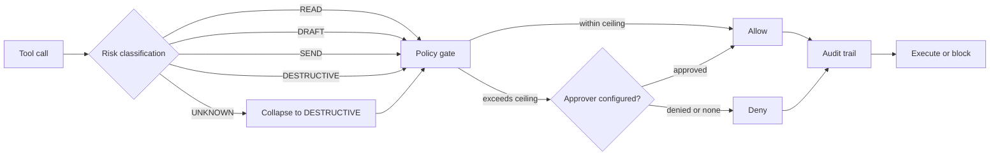
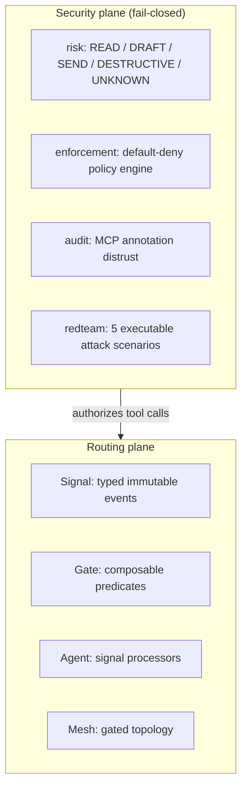

# SGP Python SDK

The control plane for agentic AI. Typed signals route work between agents. Fail-closed gates decide which tool calls execute.

Every agent framework in 2026 ships permissive tool defaults. MCP defines no per-tool ACL: any tool an agent can see, it can call. SGP is the layer that was missing. Every tool call is classified, gated, and audited before it executes. Unknown tools are denied. The overhead is 2.3 microseconds.

## The problem

An agent with 40 tools and no authorization layer will eventually call the wrong one. A compromised web fetch returns attacker text with embedded instructions. An MCP server declares `readOnlyHint` on a tool that writes. A malicious tool registers under a trusted name after the original is removed. These are not hypothetical. Each one below is an executable scenario in this repo, and the default policy blocks all five.

## Quickstart: fail-closed tool authorization

```python
from signal_gating.security import PolicyEngine, RiskLevel, ToolRisk

engine = PolicyEngine(max_auto_approve=RiskLevel.READ)
engine.register("read_file", ToolRisk(RiskLevel.READ, ("reads files",)))
engine.register("send_email", ToolRisk(RiskLevel.SEND, ("network call",)))

engine.evaluate("read_file")       # allow: READ within ceiling
engine.evaluate("send_email")      # require_approval: SEND exceeds ceiling
engine.evaluate("delete_database") # deny: unknown tool, default deny
```

Two rules. Everything else follows:

1. **Unknown means DESTRUCTIVE.** Tools classify as READ / DRAFT / SEND / DESTRUCTIVE. Anything unclassified gates as DESTRUCTIVE and never auto-executes.
2. **Denial is the default.** Approval is explicit, per tool, audited. Every decision lands in an append-only audit trail.

Wire it into an agent mesh so every tool call is evaluated:

```python
from signal_gating.core import Agent

worker = Agent("worker", gates=[engine.as_gate("worker")])
```

Declare risk on your tools explicitly. The heuristic classifier is a first pass only; `risk=` always wins:

```python
@worker.tool(description="Delete a record", risk=RiskLevel.DESTRUCTIVE)
async def delete_record(record_id: str) -> dict:
    ...
```

## Attacks blocked

| Attack | What happens | What stops it |
|---|---|---|
| Prompt injection via tool output | Compromised tool returns attacker instructions; agent obeys | SEND-classified follow-on tool requires approval |
| MCP privilege escalation | Server declares `readOnlyHint` on a tool that writes | Annotation audit fails the lying tool |
| Data exfiltration | "Summarize" tool hides a POST to an attacker endpoint | Observed behavior contradicts declared READ |
| Tool squatting | Malicious tool registers under a trusted name | Unknown binding denied by default |
| Unclassified auto-execution | New tool with no risk classification | UNKNOWN gates as DESTRUCTIVE, denied |

Run them yourself:

```bash
PYTHONPATH=src python benchmarks/bench_attack_block.py
```

```
block rate: 5/5
Verdict: every documented attack class is stopped by default policy.
```

## Architecture

Every tool call flows through one path. There is no bypass.



Unregistered tools never reach the gate. They are denied at lookup, before classification. Every decision is recorded with timestamp, tool, risk level, and reason. Dry-run mode evaluates without enforcing, so policies can be validated against production traffic before they bite.

The two planes:



The security plane sits in front of the routing plane. Tool calls are authorized before they execute. Signal flow between agents is shaped by composable gates. Both planes write to the same audit trail.

SGP complements MCP and A2A. Those protocols move tools and messages. SGP decides which ones are allowed to run.

### Cost of the control plane

Gating overhead is 2.3 microseconds p50 per evaluation. A single LLM tool-call round trip is 200 to 2000 milliseconds. The control plane is effectively free.

```bash
PYTHONPATH=src python benchmarks/bench_gating_latency.py
```

### What else is in the security plane

- **MCP annotation distrust** (`audit_tool`): servers self-declare `readOnlyHint` / `destructiveHint`. The audit compares the claim against statically observed behavior and fails tools that lie. The Agentjacking class proved annotations are not a trust signal.
- **Policy as code** (`signal_gating.policy`): declarative YAML policies, first-match-wins rules, versioning, dry-run mode.
- **Agent Skills compatibility** (`signal_gating.skills`): export SGP tool surfaces as skills, load installed skills with risk classification.

See `examples/secure_agent.py` for the full wired example.

## Routing: signals, gates, agents

The routing plane moves typed work between agents. The security plane above decides what executes.

```python
import asyncio
from signal_gating.core import Agent, Gate, Mesh, Signal

class TaskSignal(Signal):
    task: str

planner = Agent("planner")
worker = Agent("worker", gates=[Gate.by_priority(3)])

@worker.on(TaskSignal)
async def handle(signal: TaskSignal):
    print(f"Working on: {signal.task}")

mesh = Mesh([planner, worker])
mesh.connect(planner, worker)

async def main():
    async with mesh:
        await planner.emit(TaskSignal(task="build feature", priority=5))

asyncio.run(main())
```

A clean `async with mesh` exit waits for queued and in-flight work. To wait while keeping the mesh open, use `await mesh.wait_idle(timeout=10)`; a timeout names the agents still busy instead of silently dropping work.

Run the measurable demo:

```bash
signal-gating-demo
```

```
signals_in=12
signals_admitted=3
handler_load_reduction=75.0%
critical_incidents_preserved=3/3
result=PASS
```

Six low-priority alerts and two copies of three critical incidents go through real `by_priority` and `deduplicate` gates. Handler invocations drop 75% against the ungated baseline. All three unique critical incidents survive.

## Stable core

Production integrations import from `signal_gating.core`:

```python
from signal_gating.core import (
    Agent,
    Gate,
    Mesh,
    MeshEvent,
    Receipt,
    Signal,
    TrajectoryRecorder,
)
```

Package-root imports stay compatible through `0.1.x`. Pools, teams, scripts, LLM helpers, task boards, and improvement loops are alpha; their APIs may change before `1.0`.

## Core primitives

### Signal

Typed, immutable events. Subclass to define your domain:

```python
class AlertSignal(Signal):
    message: str
    severity: int = 0
```

Signals are immutable. Use `evolve()` for modified copies:

```python
alert = AlertSignal(message="CPU spike", severity=8)
escalated = alert.evolve(severity=10)
```

### Gate

Composable predicates that control signal flow:

```python
high_priority = Gate.by_priority(5)
dedup = Gate.deduplicate(window=60)

pipeline = high_priority >> dedup  # chain
either = Gate.by_type(AlertSignal) | Gate.by_priority(10)  # or
both = high_priority & Gate.filter(lambda s: s.source == "sensor")  # and
```

Starter gates: `by_type`, `by_priority`, `filter`, `transform`, `deduplicate`, `passthrough`. Advanced: `rate_limit`, `throttle`, `retry`, `circuit_breaker`, `timeout`, `ttl`, `debounce`, `sample`, `when`, `block`, `tap`, `batch`, `parallel`, `fallback`, `window`, `map`.

### Agent

Autonomous signal processors with lifecycle, request/response, and priority inboxes:

```python
worker = Agent("worker", gates=[Gate.by_priority(3)], priority_inbox=True)

@worker.on(TaskSignal)
async def handle(signal: TaskSignal):
    result = await process(signal.task)
    await worker.reply(signal, ResultSignal(result=result))
```

Request/response with timeout:

```python
response = await planner.request(TaskSignal(task="analyze data"), timeout=5.0)
```

If a processing loop crashes, supervision restarts it with exponential backoff. Handler exceptions go to the dead-letter queue; processing continues.

### Mesh

Gated agent topology with content-based routing:

```python
mesh = Mesh([coordinator, analyst, reporter])
mesh.connect(coordinator, analyst, gate=Gate.by_priority(5))

mesh.route(coordinator, [
    (lambda s: s.priority >= 8, critical_handler),
    (lambda s: isinstance(s, AnalysisTask), analyst),
], default=general_worker)
```

Coordination patterns: `scatter` (all-or-nothing fan-out), `map_reduce`, `branch_workflow`, `workflow` (sequential chain), `race` (first response wins). See the docstrings; each names its failure mode instead of hiding it.

### Tool calling

Agents expose tools that other agents discover and invoke:

```python
@analyst.tool(description="Analyze data and return insights", risk=RiskLevel.READ)
async def analyze(data: str, depth: int = 1) -> dict:
    return {"insights": await run_analysis(data, depth)}

result = await mesh.call_tool(analyst, "analyze", data="revenue Q4", depth=2)
```

`Agent.tool()` accepts async and sync functions. Set `risk=` on every tool; undeclared tools default to UNKNOWN and never auto-execute under a fail-closed policy.

### Tracing and trajectories

Lightweight observability in memory, exportable to OpenTelemetry when needed. `TrajectoryRecorder` captures a verifiable JSONL record of mesh events with sha256 digests per receipt, replayable as the original signal types.

### LLM-backed agents

`LLMAgent` gives an agent an OpenAI-compatible brain. Treat model output as untrusted: `MeshToolProvider` requires an explicit agent-and-tool allowlist, applied at schema generation and at execution. Unknown names fail immediately. See `examples/hermes_mesh.py`.

## Install

```bash
pip install "signal-gating @ git+https://github.com/signalgatingprotocol/python-sdk@ad5bed9"
```

For LLM-backed agents:

```bash
pip install "signal-gating[llm] @ git+https://github.com/signalgatingprotocol/python-sdk@ad5bed9"
```

For OpenTelemetry export:

```bash
pip install "signal-gating[otel] @ git+https://github.com/signalgatingprotocol/python-sdk@ad5bed9"
```

The pinned commit makes installs reproducible. After the first PyPI release, the stable command will be `pip install signal-gating`. See [CHANGELOG.md](CHANGELOG.md) for scope and stability notes.

## Development

```bash
pip install -e ".[dev]"
pytest
ruff check .
mypy src/
```

826 tests pass. The five red-team scenarios run as regression tests: if any ever reports unblocked, the control plane has regressed.

## License

Apache 2.0
