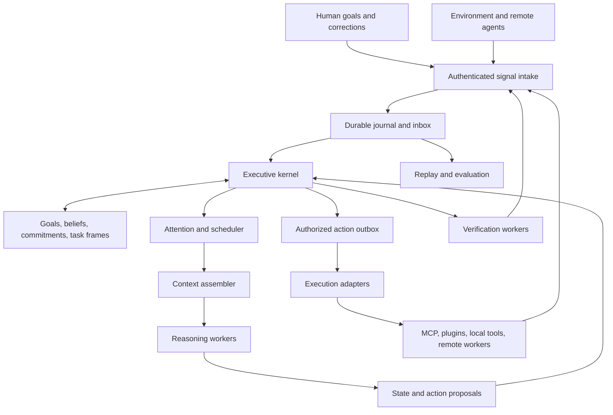

# SGP executive kernel

Date: 2026-11-07

Status: Approved by the user on 2026-11-07; builder review complete. Implementation planning authorized.

Scope: Long-term architecture and a buildable first implementation. This document does not authorize a release or claim that the proposed behavior already exists.

## 1. Intent

SGP should let an agent hold human intent over time while intelligently managing competing demands on its attention. Goals, constraints, commitments, and evidence must survive individual model calls, session boundaries, interruptions, and worker failures. The system should change course when warranted, preserve work that remains valid, and distinguish progress from merely taking actions.

The chosen architecture is a persistent executive kernel. Models contribute reasoning through bounded worker episodes. The kernel maintains state and controls admission, scheduling, context assembly, execution, and completion. Its long-term destination is interoperable executives that coordinate across runtimes and organizations while retaining local authority.

The design borrows functional ideas from executive-function research: inhibition, selective working-memory updating, task switching, and allocation of effort. These are engineering hypotheses. SGP is not a neurological simulation, and biological inspiration does not establish effectiveness or novelty.

The user selected this architecture and the enduring-intent vision. Storage, interface, scheduling, and rollout choices below are proposed engineering decisions, not previously agreed requirements.

## 2. Goals, non-goals, and failure conditions

### Goals

- Maintain explicit, revisable goals and commitments over arbitrarily many bounded reasoning episodes.
- Admit observations selectively into attention and working memory without losing access to retained evidence.
- Handle interruptions, corrections, and resumption with explicit state transitions.
- Execute only actions authorized against current constraints; account for ambiguous external outcomes.
- Require task-specific evidence before accepting completion.
- Make executive decisions inspectable and evaluable across different models and runtimes.
- Preserve a path to portable executive contracts and federation without requiring a distributed system in the first implementation.

### Initial non-goals

- Replacing MCP, plugin packaging, model APIs, or existing agent transports.
- Building a new foundation model, vector database, general workflow language, or neurological simulator.
- Claiming exactly-once external effects, general prompt-injection protection, or security against a malicious host process.
- Automatic online policy training, global multi-kernel consensus, or a public protocol standard in the first release.
- Requiring users to migrate their existing agents into an SGP-specific agent class.

### Anti-goals

- A supervisor model that must remember every important fact in its own transcript.
- A framework whose success is measured by agents spawned, messages routed, or tokens suppressed.
- Forgetting a human constraint through summarization, or interpreting retrieved content as authority.
- Treating silence, missing evidence, or successful transport as task completion.
- Spending more on control than it saves without a corresponding improvement in task outcomes.
- Requiring provider-specific hidden reasoning or making learned policy able to grant permissions.

## 3. Approaches and decision

| Approach | Advantages | Costs and limits |
| --- | --- | --- |
| Executive supervisor model | Flexible orchestration; simple initial integration | Goal continuity and policy compliance depend heavily on the supervisor's context and behavior |
| **Persistent executive kernel, selected** | Explicit continuity, enforced transitions, replaceable workers, inspectable decisions | Requires careful state, execution, and failure semantics |
| Federated executives first | Distributed ownership and independent implementations from the outset | Adds trust, delivery, and reconciliation problems before local executive behavior is established |

The user selected the kernel. Federation remains the architectural destination. The local kernel establishes semantics that can later cross a process or organizational boundary.

## 4. System boundary and components



The first deployment is one local kernel process for one trust domain, using Python and asyncio. It can supervise several concurrent worker episodes, but one serialized transaction path commits executive state. A human or application interacts through a typed Python API and an inspectable local status interface. A daemon, web UI, and network API are later adapters, not required foundations.

The kernel is the sole writer of authoritative state. Workers return proposals; they do not write the state database. External tools run through adapters that define capabilities and effect semantics. Process isolation and scoped credentials are deployment controls, not properties of a Python object interface.

## 5. Authoritative data model

All records have stable IDs, a schema version, and monotonically increasing revisions. Timestamps are UTC. Monetary budgets use integer units with an explicit currency; token and call budgets use integers. No model-generated floating-point score grants authority.

| Record | Required content |
| --- | --- |
| `Principal` | Identity, trust domain, authenticated origin, allowed roles |
| `Goal` | Owner, outcome, structured constraints, completion criteria, status, revision, parent if any |
| `Commitment` | Goal, responsible party, dependencies, deadline if any, budget reference, status |
| `Belief` | Typed claim or text claim, scope, evidence references, epistemic status, revision, validity interval if known, supersession links |
| `TaskFrame` | Commitment, current subgoal, progress artifacts, open questions, dependency revisions, pending actions, resume brief, status |
| `Grant` | Issuer, subject, capabilities, resource scope, restrictions, expiry, revocation revision |
| `Budget` | Scope, limits, reserved amounts, actual use, accounting uncertainty |
| `ArtifactRef` | Content digest, storage location, media type, origin, access scope, retention class |
| `Signal` | ID, producer ID and sequence if available, kind, received time, observed time if known, causal links, scope, payload or artifact references |
| `Proposal` | Worker episode, affected records, read set of revisions, requested mutations or action, evidence, justification |
| `DecisionReceipt` | Signal/proposal, state revisions, policy version, disposition, reason code, evidence references, new event IDs |
| `ActionRecord` | Stable action ID, capability binding, arguments digest/reference, authorization revision, budget reservation, delivery state, external receipt |
| `Episode` | Task, lease/fencing token, context packet ID, model/provider configuration, allowed proposal types, deadline and usage |

Beliefs distinguish `supported`, `hypothesis`, `disputed`, and `retracted`. "Supported" means the configured evidence policy was met, not that the claim is universally true. Confidence is optional and includes its source and calibration status. Contradictory claims can coexist as disputed; the system does not silently choose the newest or highest-scoring statement.

Hard constraints have stable IDs and explicit enforcement mechanisms. Free-text preferences remain soft unless translated into a reviewed rule or checkable criterion. An unresolved hard constraint blocks dependent consequential actions or requires human review; schema validity alone never proves semantic compliance.

Goals and commitments are separate: a goal expresses the intended result; a commitment records accepted responsibility for part of that result. A dependency graph links tasks, beliefs, artifacts, and criteria. Cyclic task dependencies are rejected at commit time. A belief revision invalidates dependent proposals and findings, not unrelated work.

## 6. Persistent storage and transaction model

**Engineering decision:** SQLite in WAL mode plus a local content-addressed artifact directory for the first implementation. Use standard migrations and transactional constraints. A second writable kernel process on the same store is unsupported and refused by a process ownership lock. A remote store can later implement the same logical interface.

One transaction commits:

1. Acceptance of an inbox item or proposal, including deduplication.
2. Journal events describing the decision and state changes.
3. Materialized state revisions.
4. Budget reservations and any action outbox entries.
5. The corresponding decision receipt.

External calls never occur inside this transaction. Artifacts are written atomically before their references are committed; orphaned unreferenced artifacts can be collected. An artifact reference with missing or corrupted bytes is an explicit error and cannot satisfy verification.

The journal is append-only during ordinary operation. Its events are the source of truth; views are rebuildable. Reducers are deterministic and cannot invoke a model, tool, or network service. Store model decisions and external observations as events so recovery replays facts rather than re-asking questions.

Event formats are versioned. Migration preserves interpretable history or creates an explicit migration boundary with a validated snapshot. Unsupported versions fail clearly. Checksums detect accidental corruption; they are not signatures.

Retention is explicit. Preserve live goals, unresolved commitments, active authority, and evidence required for current findings. Raw prompts and tool output may contain secrets, so persistence uses allowlisted metadata and access-controlled artifact references rather than indiscriminate logging. Retention or deletion can remove evidence; dependent findings must then become unverifiable. Exact historical replay is only promised within retained coverage. Initial cleanup is explicit, not automatic age-based deletion of active commitments.

## 7. Intake, authority, and event ordering

Authenticated adapters assign principal identity; a payload's claimed identity is never sufficient. Human instructions arrive through a trusted control interface. A document containing instructions remains evidence, not a control message.

Deduplicate by stable signal ID and producer scope. A duplicate returns the original intake receipt. Different IDs with equivalent content may be coalesced for attention, but their provenance remains recorded. Reject excessive envelopes at intake and record a bounded rejection record.

Committed journal sequence establishes local order. Producer timestamps inform freshness; they do not reorder committed authority. Late observations may revise beliefs but cannot silently roll back a newer human instruction. Conflicting authorized instructions become an explicit conflict with affected work blocked until resolved. Host-enforced restrictions remain above ordinary goal instructions.

Control events such as revocation, stop requests, and goal corrections have a separate bounded queue and are serviced before scheduling new ordinary work. Already issued external effects cannot be recalled. Once a correction is acknowledged as committed, later dispatch must use its authority revision.

## 8. Executive cycle and gates

For each admitted item, the kernel executes a short deterministic cycle:

1. Resolve scope, provenance, and relevant state.
2. Apply non-negotiable authority and validity rules.
3. Route obvious events through deterministic policy.
4. If judgment is needed, persist an assessment task and continue servicing other events.
5. Validate returned proposals against current dependencies.
6. Commit a disposition and its effects atomically.
7. Reconsider runnable work affected by the transition.

A model assessment is itself a bounded episode with a deadline and budget. There is no recursive "assess whether to assess" loop. On invalid output or timeout, keep existing state, record failure, and defer or request review according to policy. Never turn assessment failure into permission.

| Gate | Inputs | Dispositions |
| --- | --- | --- |
| Attention | Signal, active tasks, deadlines, relevance evidence, available budget | `process`, `defer`, `coalesce`, `archive` |
| Memory | Proposed claim, provenance, existing beliefs, evidence policy | `admit`, `revise`, `dispute`, `reject`, `request_evidence` |
| Execution | Action, current grant, constraints, capability binding, budget | `authorize`, `deny`, `require_review`, `stale` |
| Completion | Criterion results, artifacts, dependency revisions | `accept`, `insufficient_evidence`, `contradicted`, `needs_human` |

Gate decisions are typed results. They are not encoded as `None`, dropped exceptions, or free-form strings. Existing `Gate` behavior remains compatible; these executive gate contracts are a separate experimental surface.

## 9. Attention, scheduling, and continuity

The first scheduler uses explainable deterministic rules, with optional bounded model judgments about relevance. Learned scheduling is later work.

Scheduling order is: committed human control changes; reconciliation of uncertain consequential actions; urgent runnable obligations; other runnable work. Within ordinary work, use declared priority, deadline proximity, aging, and estimated benefit/cost when available. Estimates carry provenance and may be unknown. Producer-declared urgency is advisory. Finite per-class quotas and aging prevent ordinary tasks from being permanently starved; sustained control overload is surfaced rather than silently dropped.

Every deferred item has a wake condition: a time, dependency change, new evidence, or human decision. An archived item is retained subject to policy but has no wake obligation. A commitment cannot disappear merely because one associated signal was archived. Idle means no runnable work, not completion.

Use one active episode per task frame initially. Multiple independent tasks may run concurrently under a kernel-wide limit and atomic shared budget reservations. Repeated equivalent failures with unchanged relevant state create a blocked condition after a configurable finite retry allowance. Repeating an action requires new evidence, an explicit retry policy, or human intervention.

Task lifecycle:

```text
pending -> ready -> running -> verifying -> completed
                    |             |
                    +-> suspended +-> ready (specific verification gap)
                    +-> blocked
                    +-> failed
suspended -> ready (wake condition satisfied)
blocked -> ready (blocker resolved)
any nonterminal -> cancelled (authorized cancellation)
```

Task transitions are validated. Goal completion separately checks its required commitments and criteria; optional tasks do not block it. An accepted result later invalidated by evidence receives a new invalidation event and can reopen the goal. Historical completion is preserved as history, not overwritten.

Suspension revokes the episode's right to commit and stores the task frame, evidence references, pending effects, and resume brief. The kernel can cancel an in-flight model request, but correctness does not depend on cancellation succeeding. Late proposals with old fencing tokens are rejected. Resume starts a new episode from persisted state. A model-authored resume brief is helpful but never the only record of constraints or outstanding effects.

## 10. Context assembly and worker contract

Context assembly creates a versioned packet with:

- Goal and task identity, current outcome, completion criteria, and applicable hard constraints.
- Relevant commitments and dependency revisions.
- Selected beliefs with epistemic status and evidence references.
- Material changes since the previous episode, unresolved contradictions, and pending effects.
- Capability descriptions for this episode and remaining resource limits.
- A manifest of included material, omitted candidate references, selection reasons, and token accounting.

The worker sees explicit boundaries between authority, evidence, and hypotheses. Trusted instructions are never reconstructed solely from a lossy summary. Required context must fit the configured model budget; otherwise split the task or block with `context_budget_insufficient`. Never silently truncate a hard constraint. Optional evidence is ranked and can be retrieved through bounded evidence requests.

Artifact retrieval enforces access scope before providing content. Omission logs can reference artifacts without exposing their contents to unauthorized consumers. A context packet records the actual rendered input and versions sufficiently for inspection within retention policy; it does not promise reproducible model sampling.

Workers implement this conceptual interface, with concrete Python types to be defined in the implementation plan:

```python
async def run_episode(packet: ContextPacket) -> EpisodeResult:
    ...

# EpisodeResult contains zero or more typed proposals, usage,
# and a stop reason: proposed, needs_evidence, blocked, or exhausted.
```

Proposal types include `BeliefChange`, `TaskDecomposition`, `ActionIntent`, `EvidenceRequest`, and `CompletionClaim`. The kernel validates types, references, authority, dependency cycles, budgets, and transition preconditions. A task decomposition inherits parent restrictions and cannot expand grants or the parent budget. A model's natural-language rationale is not a validator.

Workers never need private chain-of-thought. They provide concise reasons and evidence. An adapter may wrap an existing agent runtime; however, a runtime that executes tools outside the mediated interface cannot claim SGP enforcement for those effects. Such integrations must be explicitly observation-only or restricted to compatible execution paths.

## 11. Proposal freshness and execution

A proposal includes a read set of record IDs and revisions and the episode fencing token. Mandatory dependencies are attached by the kernel: goal constraints, authority, task frame, and the context's supplied belief revisions. Workers may add dependencies but cannot remove mandatory ones. The first implementation conservatively treats all supplied beliefs as dependencies; finer tracking requires later evidence.

On commit, changed relevant dependencies yield `stale`; the worker receives the delta or a new task. Unrelated state revisions do not invalidate the proposal. A human approval is bound to the action ID, canonical arguments digest, resource scope, and relevant constraint revision. Material changes invalidate that approval.

An execution adapter declares its versioned capability binding, input schema, effect class, resource scope rules, cancellation behavior, idempotency support, reconciliation method, and usage accounting. Model-visible descriptions alone do not define its privileges. Tool replacement changes its binding and invalidates outstanding authorizations.

Action lifecycle:

```text
proposed -> denied | awaiting_review | authorized
authorized -> dispatching -> succeeded | failed | outcome_unknown
authorized -> cancelled (before dispatch)
outcome_unknown -> reconciling -> succeeded | failed | needs_human
```

The outbox dispatcher rechecks current authority, dependencies, expiry, and budget immediately before marking `dispatching`. This transition is the local dispatch linearization point. A later revocation stops future dispatches but cannot guarantee prevention of an already authorized external effect. Where needed, resource-side checks enforce current grants at execution time.

Persist the stable action ID and idempotency key before dispatch. After a crash, a `dispatching` action is treated as `outcome_unknown`. If the adapter supports durable idempotency, retry with the same key within its documented scope and retention window. Otherwise reconcile through a status lookup or ask a human. Do not claim exactly-once execution or blindly repeat a non-idempotent effect. Compensation is a separate authorized action, never an assumed rollback.

No configured approver means review remains pending. Human-only actions can be prepared as artifacts but have no executable capability in the agent's grant. In Preston's environment, outbound email is human-only and must never be queued or transmitted by this kernel.

## 12. Budgets and bounded deliberation

Reserve resources before starting episodes, verification, or tool actions. Reservations are shared across sibling tasks and deducted from ancestor budgets. Set explicit per-call output limits and execution deadlines. Reconcile actual usage on completion; uncertain usage retains a conservative reservation until reconciled or explicitly resolved.

A strict monetary ceiling is only enforceable for adapters that expose a defensible maximum charge. An adapter without that bound must use explicit human authorization for uncertain spending or be denied under strict policy. Estimates are reported as estimates. Tokens, calls, elapsed time, and currency are separate quantities.

Reserve some control capacity for processing stop requests, persisting state, and explaining blocked conditions. That does not authorize additional paid model calls beyond the budget. Budget exhaustion suspends discretionary work and surfaces its state; it does not imply task completion.

## 13. Completion and feedback

Each completion criterion has an ID, evaluator type, inputs, acceptance rule, and required evidence. Evaluators can be deterministic checks, separate model judgments, or explicit human approvals. The selected type and its limits remain visible. Model agreement is not independent ground truth.

Verification runs against identified artifact versions and current relevant constraints. A late verifier result is subject to the same freshness checks as a worker result. Failed verification creates named gaps and bounded follow-up work. Completion records what was checked, by which verifier, under which policy, and with which artifacts.

Receipts connect scheduling decisions and outcomes for subsequent evaluation. Offline policy candidates can be compared and promoted explicitly. Live self-modification of grants, hard constraints, verification criteria, or budget ceilings is prohibited. Replay can reproduce committed transitions; counterfactual model or environment behavior requires fresh evaluation and cannot be inferred from the old journal alone.

## 14. Recovery, observability, and interaction

Startup validates the database and schema, restores views, expires old episode leases, wakes eligible commitments, and reconciles incomplete action records. Running tasks with lost workers return to `ready` only if their effects are settled; otherwise they become `blocked` on reconciliation. A kernel outage does not cancel an external task by assumption.

Initial human operations are: create/revise/pause/resume/cancel a goal; inspect state and receipts; resolve a conflict; approve or deny a specific pending action; attach evidence; request re-verification. Goal creation validates that its owner and policy are known. Goal revision cannot silently rewrite another principal's authority.

Expose answers to: what is active, what is deferred and why, what changed, what is believed and on which evidence, what is blocked, what was spent/reserved, and what would allow progress. Provide structured JSON for agents and a small readable local interface for operators. A dashboard is optional.

Key observability measures: verified completion, constraint violations, missed material updates, resumption correctness, wasted or repeated actions, control overhead, queue age, unresolved effects, and evidence freshness. Logs and metrics are not a substitute for task outcomes.

## 15. Concrete acceptance scenario

Goal: prepare a release with compatibility evidence and a reviewable artifact. Deployment requires separate explicit authorization.

1. A worker starts fixing a test against goal revision 4.
2. The human adds a Python 3.10 requirement. Intake commits revision 5 and acknowledges it.
3. A delayed proposal based on dropping 3.10 arrives. Its read set includes revision 4; commit returns `stale`. No action is dispatched.
4. A passing test artifact unrelated to the changed requirement remains available. It does not satisfy compatibility verification.
5. Repeated equivalent log events are coalesced without deleting their provenance or pending obligations.
6. An urgent correction suspends this task. The episode token is revoked and its task frame retained.
7. The process restarts. The task is reconstructed, with budget and constraints intact; unknown external effects block dependent retries.
8. Resume supplies the current requirement, valid artifacts, and unresolved compatibility check.
9. Verification evaluates the resulting artifact on the required versions. The release-preparation goal completes only when its criteria pass. Deployment remains outside its grant.

This scenario must run first with deterministic workers to test semantics, then with real model workers to measure behavior. Fixture success establishes the former only.

## 16. Integration with the existing project

Preserve `signal_gating.core` and existing `Signal`, `Gate`, `Agent`, `Mesh`, and receipt behavior. Develop executive contracts in a distinct experimental namespace, proposed as `signal_gating.executive`. Do not silently reinterpret legacy receipts as proof of authorization or task success.

Reuse immutable signal and serialization conventions where compatible. Bridge legacy mesh events through an adapter that supplies explicit provenance and scope. Reuse evaluation/history utilities where they satisfy these contracts. Existing JSONL trajectory replay is not the new kernel's transactional recovery mechanism. Do not force SQLite transactions through a file replay abstraction that lacks the required semantics.

An existing agent or mesh can be a worker behind an adapter. Kernel use should not require adopting a mesh. Deprecation or removal of existing alpha orchestration features is a separate decision after the new boundary is proven.

The local checkout contains untracked decision-routing work. This design neither adopts nor overwrites it. Recent remote work checked during design drafting concerns policy fixes, dependency updates, and CodeQL; no duplicate executive-kernel PR was identified in that recent listing.

Repository outcome-evidence rules continue to apply. Design approval permits planning; it is not evidence of production savings, model quality, or general protection. Any implementation plan must identify an explicit experimental scope and the evidence required before broader framework expansion.

## 17. Development horizons

These are capability horizons, not a detailed implementation plan or calendar promise.

| Horizon | Deliverable | Exit evidence |
| --- | --- | --- |
| A. Local executive semantics | Store, reducer, intake, task state, deterministic gates, context packets, workers, outbox, verification, restart | Acceptance scenario plus invariant and fault-injection tests |
| B. Useful model integration | One real worker adapter, mediated tools, selective context, bounded assessments | Held-out task comparison against a strong conventional harness and simple rules |
| C. Adaptive control | Offline scheduling/memory policy evaluation, promotion and rollback | Improvements across repeated tasks with measured overhead and no hidden constraint regressions |
| D. Portable contracts | Versioned schemas, transport binding, independent implementation, conformance suite | Cross-runtime lifecycle and failure interoperability |
| E. Federated executives | Delegated commitments, scoped authority, evidence exchange, revocation and reconciliation across owners | Partition, duplicate-delivery, stale-state, and trust-boundary tests plus useful joint tasks |

Long-term federation uses local authority and causal references, not a globally synchronized mind. A delegation specifies outcome, evidence requirements, budget responsibility, expiry, and cancellation semantics. Receiving kernels explicitly accept or reject responsibility. A remote claim of completion is evidence submitted to local verification. Partitions leave commitments visibly pending or uncertain; they do not manufacture success. Broader trust and transport details belong to horizon D/E designs.

## 18. Evaluation and definition of excellence

Compare identical task sets and worker models under:

1. A conventional harness with competent compaction and task notes.
2. Simple priority, deduplication, and explicit task-state rules.
3. The executive kernel with its proposed context and scheduling policies.

Use tasks containing corrected requirements, irrelevant interruptions, contradictory evidence, stalled dependencies, repeated failures, and restart points. Include tasks that need no elaborate control to expose overhead. Use separate tuning and held-out cases and repeated runs. Report failures and uncertainty, not just averages.

Measure verified completion, hard-constraint violations, response to material corrections, correct resumption, redundant actions, human interventions, latency, and total resource cost including assessment and verification. Test memory gating and scheduling separately through ablations. Set task-specific acceptance thresholds before measured runs; do not invent a universal accuracy or savings target in this architecture document.

Protocol invariants must hold in deterministic tests: no stale proposal commits; no unauthorized mediated dispatch; no oversubscribed bounded budget; no duplicated commitment from duplicate delivery; no completion without required evidence; no blind retry after an ambiguous consequential effect. Test crashes around every outbox transition and recovery boundary.

The architecture is valuable if these mechanisms help agents sustain useful intent across changing circumstances at acceptable cost. Passing fixtures is necessary engineering evidence. Real task improvements and independent adoption establish usefulness and portability separately.

## 19. Builder discretion and remaining decisions

The builder may choose internal table names, Python module boundaries, ID format, migration tooling, serializer, testing libraries, and readable CLI formatting. These choices must preserve the semantic contracts above and the compatibility API.

The implementation plan must select a concrete worker/provider adapter, a local mediated tool set, task fixtures and held-out cases, numerical scheduler defaults, and measured acceptance thresholds. The initial baseline can use the repository's OpenAI-compatible client interface, but the kernel contracts must not depend on it. These are bounded planning choices; no foundation-model purchase, hosted deployment, or paid run is implied by design approval.

No unresolved product choice prevents planning the local kernel. Federation authentication, transport bindings, multi-tenant deployment, and learned-policy training are deliberately reserved for their later horizons.

An independent builder check on 2026-11-07 reported no important unanswered questions preventing implementation planning. This checks design completeness, not implementation correctness or demonstrated effectiveness.

## 20. Research grounding and limits

- [Miyake et al., executive-function unity and diversity](https://pubmed.ncbi.nlm.nih.gov/10945922/): supports distinguishing updating, inhibition, and shifting. It does not validate these software mechanisms.
- [O'Reilly and Frank, working-memory gating](https://pubmed.ncbi.nlm.nih.gov/16378516/): motivates selective updates and maintenance of relevant state.
- [Shenhav et al., expected value of control](https://pubmed.ncbi.nlm.nih.gov/23889930/): motivates explicit effort allocation rather than treating control as free.
- [MAST](https://arxiv.org/abs/2503.13657): documents system-design, coordination, and verification failure modes in evaluated multi-agent systems.
- [Anthropic context engineering](https://www.anthropic.com/research/effective-context-engineering-for-ai-agents) and [long-running harnesses](https://www.anthropic.com/research/effective-harnesses-for-long-running-agents): practical context and continuity problems and existing approaches.
- [Agent Cognitive Compressor](https://arxiv.org/abs/2601.11653) and [Soar](https://soar.eecs.umich.edu/soar_manual/02_TheSoarArchitecture/): direct prior art; a cognitive controller or bounded working state is not a new idea by itself.
- [MCP](https://modelcontextprotocol.io/specification/2026-07-28) and [A2A](https://a2a-protocol.org/latest/specification/): existing integration and coordination surfaces to complement.

These sources were examined during the preceding research discussion. The proposed contribution is the concrete executive contract and its demonstrated behavior, not a claim to have invented executive control.
